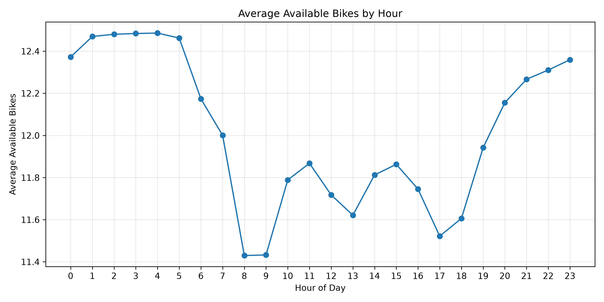
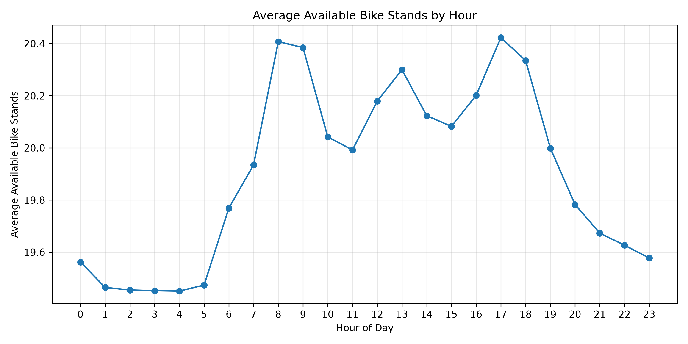
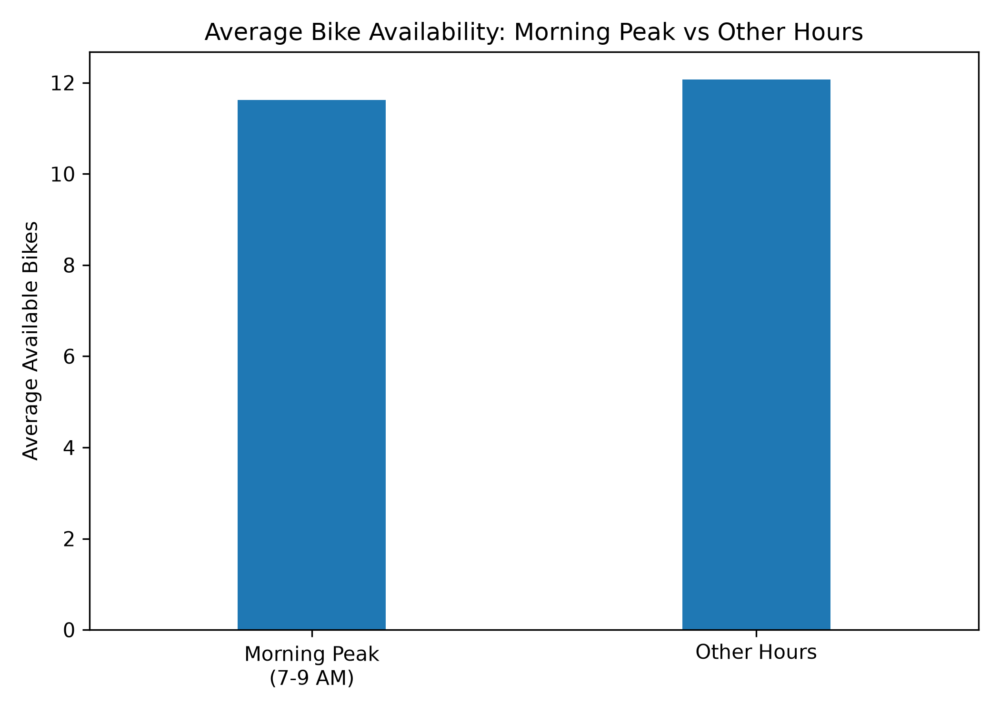
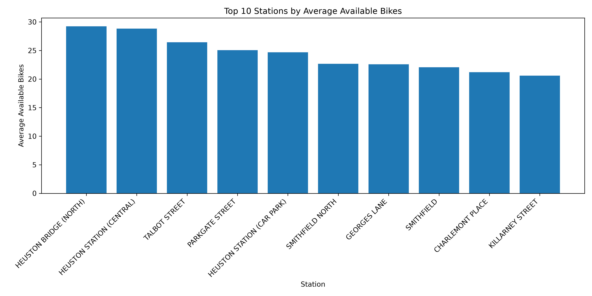
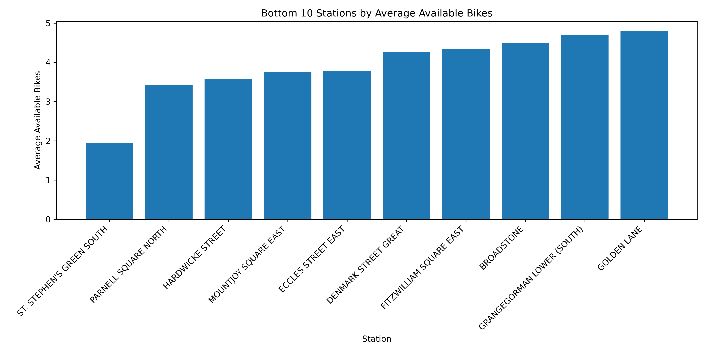
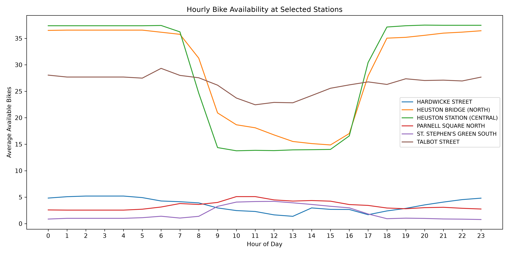
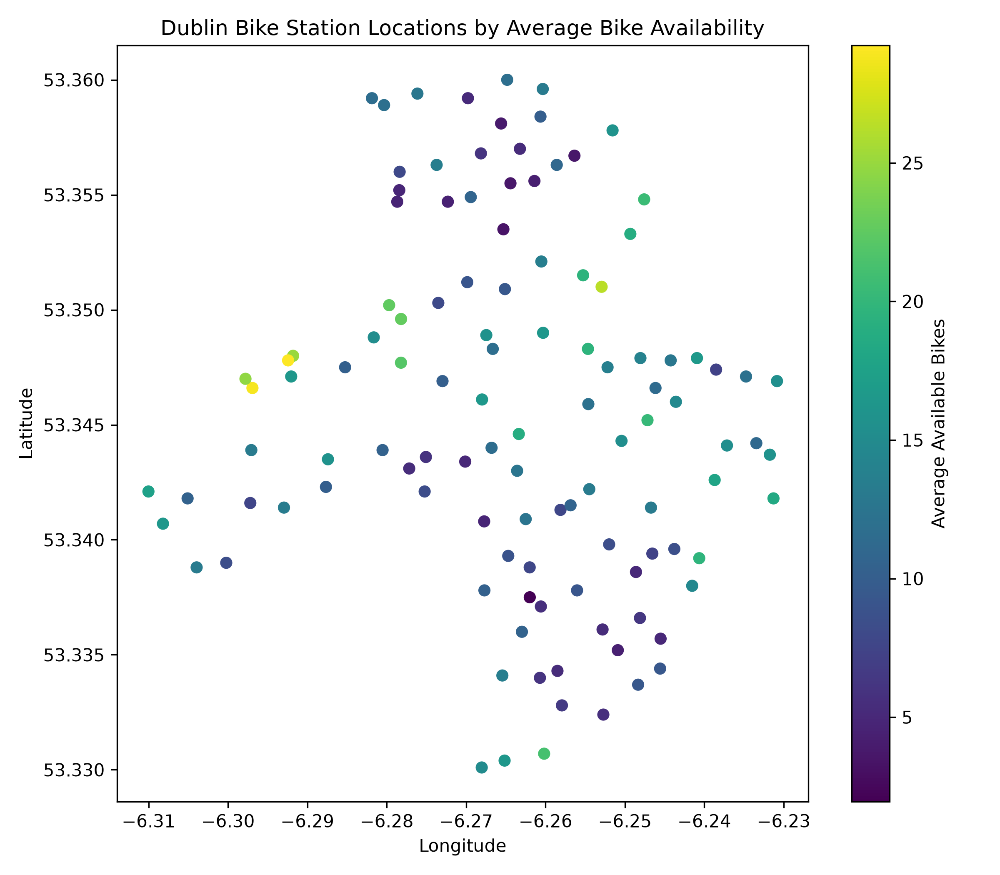
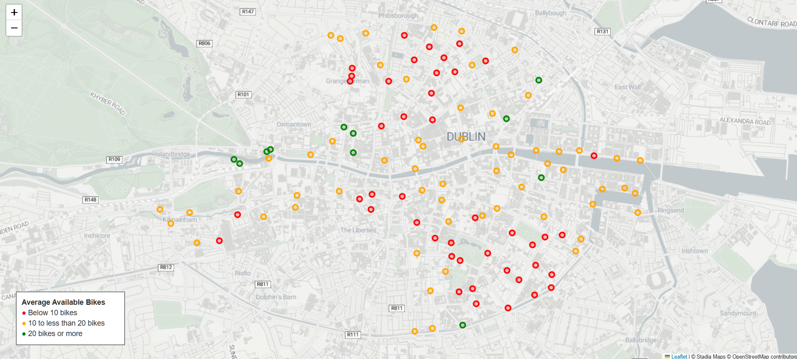
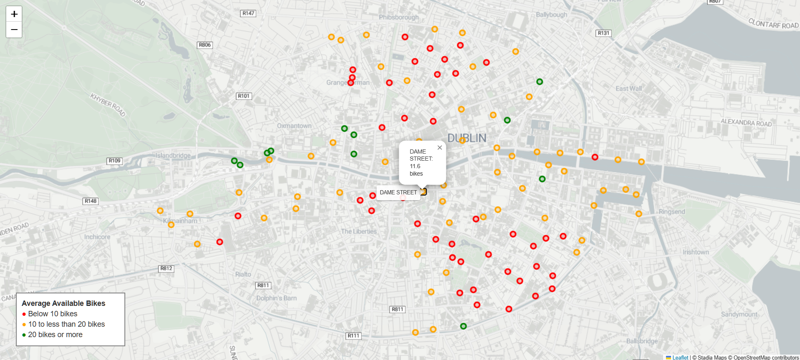
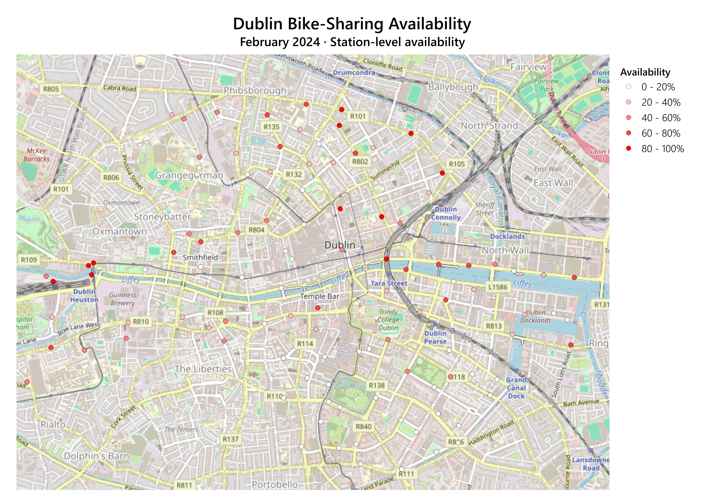

# Dublin Bike Sharing Analysis
A Python project analyzing bike availability patterns by time and station using Pandas


## Project Overview
This project analyses Dublin's bike-sharing station data from February 2024 using Python, Pandas, Matplotlib, Folium, and QGIS.

I explored hourly bike availability, compared availability across stations and time periods, and visualised station locations using static and interactive maps. I also checked the dataset for missing values, duplicates, and inconsistencies in station capacity.


## Dataset

**File:** `data/dublin_bikes_feb_2024.csv`

The dataset contains bike station status snapshots recorded throughout February 2024.

| Column | Description | Purpose |
|---|---|---|
| `STATION ID` | Unique station identifier | Station-level analysis |
| `TIME` | Timestamp of the station status record | Hourly analysis |
| `LAST UPDATED` | Last update timestamp for station information | Station update information |
| `NAME` | Station name | Station-level analysis |
| `BIKE_STANDS` | Total number of bike stands | Station capacity |
| `AVAILABLE_BIKE_STANDS` | Number of available bike stands | Dock availability |
| `AVAILABLE_BIKES` | Number of available bikes | Bike availability |
| `STATUS` | Station operating status | Status checks |
| `ADDRESS` | Station address | Location information |
| `LATITUDE` | North–south geographic coordinate | Geographic visualisation |
| `LONGITUDE` | East–west geographic coordinate | Geographic visualisation |


## Data Quality Checks

| Check | Result |
|---|---|
| Dataset size | 158,574 rows × 11 columns |
| Analysis period | February 2024 |
| Number of stations | 114 |
| Missing values | None |
| Exact duplicate rows | None |
| Records per station | 1,391 each |
| Station status | All records marked `OPEN` |
| Negative values | None in the checked availability columns |
| Capacity inconsistencies | 7,334 records |

The dataset contains 1,391 records for each of the 114 stations. A capacity inconsistency was identified when the sum of `AVAILABLE_BIKES` and `AVAILABLE_BIKE_STANDS` did not equal `BIKE_STANDS`.


## Analysis

### Hourly Bike Availability

#### Average Available Bikes by Hour

- Average bike availability peaked at 4 AM (12.49 bikes).
- Average bike availability was relatively high between 1 AM and 5 AM.
- Average available bikes reached their lowest levels between 8 AM and 9 AM (11.43 bikes).


#### Average Available Bike Stands by Hour

- Average available bike stands peaked at 5 PM (20.42 stands).
- Average available bike stands reached their lowest levels between 3 AM and 4 AM (19.45 stands).


#### Morning Peak vs Other Hours

- Average bike availability during the morning peak (7-9 AM) was 11.62 bikes.
- During other hours, average bike availability was 12.07 bikes.
- Morning peak availability was approximately 3.7% lower than during other hours.

<br>

### Station-Level Analysis
#### Top 10 Stations by Average Available Bikes

- The highest average bike availability was recorded at `HEUSTON BRIDGE (NORTH)`, with 29.24 bikes.


#### Bottom 10 Stations by Average Available Bikes

- The lowest average bike availability was recorded at `ST. STEPHEN'S GREEN SOUTH`, with 1.94 bikes.


#### Average Available Bike Stands by Station
- Highest average number of available bike stands: `MOUNTJOY SQUARE EAST` - 36.25
- Lowest average number of available bike stands: `DAME STREET` - 4.38


#### Hourly Bike Availability at Selected Stations

- `HEUSTON STATION (CENTRAL)` showed a sharp drop in average bike availability after 8 AM, followed by a recovery after 5 PM.
- `HEUSTON BRIDGE (NORTH)` showed a similar pattern, with lower availability during the morning and a recovery in the evening.
- `TALBOT STREET` had relatively stable bike availability throughout the day.
- The other three stations had lower average bike availability and smaller fluctuations throughout the day.

<br>

### Geographic Visualisation

- The map shows the locations of 114 Dublin bike stations.
- Colours represent the average number of available bikes at each station.

<br>

### Interactive Bike Station Map
The interactive map displays 114 Dublin bike stations. Marker colours represent average bike availability, and clicking a marker shows the station name and average number of available bikes in February 2024.



- 🔴 Red: Below 10 bikes
- 🟠 Orange: 10 to less than 20 bikes
- 🟢 Green: 20 bikes or more

#### How to View the Map Locally

1. Clone or download this repository.
2. Install the required libraries:

   ```bash
   pip install pandas folium
   ```

3. Run `src/05_interactive_map.py` from the project root to generate the HTML map.
4. Start a local server from the project root:

   ```bash
   python -m http.server 8000
   ```

5. Open [http://localhost:8000/outputs/dublin_bike_map_average.html](http://localhost:8000/outputs/dublin_bike_map_average.html) in your browser.

Click a station marker to view its name and average available bikes.


## QGIS Spatial Visualisation

Created a station-level map of Dublin bike-sharing availability using QGIS.



Bike availability rate was calculated as:

`Bike Availability Rate (%) = (AVAILABLE_BIKES / BIKE_STANDS) * 100`

- Calculated bike availability rates as a percentage of total station capacity.
- Used graduated colours to show availability levels from 0% to 100%.
- Visualised the spatial distribution of bike availability across central Dublin.


## Key Findings
- Average bike availability was relatively high during the early morning, peaking at 4 AM.
- Average bike availability was lowest between 8 AM and 9 AM.
- Available bikes and available bike stands generally showed opposite patterns, but their totals did not always match station capacity.
- `HEUSTON BRIDGE (NORTH)` had the highest average bike availability (29.24 bikes), while `ST. STEPHEN'S GREEN SOUTH` had the lowest (1.94 bikes).
- Some stations showed larger changes in bike availability throughout the day than others.


## Limitations
- The dataset contains station status snapshots rather than individual bike rental and return transactions.
- Average bike availability does not directly measure rental demand or the number of trips.
- In 7,334 records, `AVAILABLE_BIKES + AVAILABLE_BIKE_STANDS` did not equal `BIKE_STANDS`. The cause of these inconsistencies was not established.
- The analysis covers February 2024 only, so the findings may not represent other months or current conditions.


## Tools and Technologies
- Python
- Pandas
- Matplotlib
- Folium
- QGIS


## Data Source
- **Dataset:** [DublinBikes Historical Data - February 2024](https://data.gov.ie/dataset/dublinbikes-api/resource/1244290a-9568-4cb6-ae1f-3a19b5300842)
- **Publisher:** Dublin City Council
- **License:** [Creative Commons Attribution 4.0 (CC BY 4.0)](https://creativecommons.org/licenses/by/4.0/)